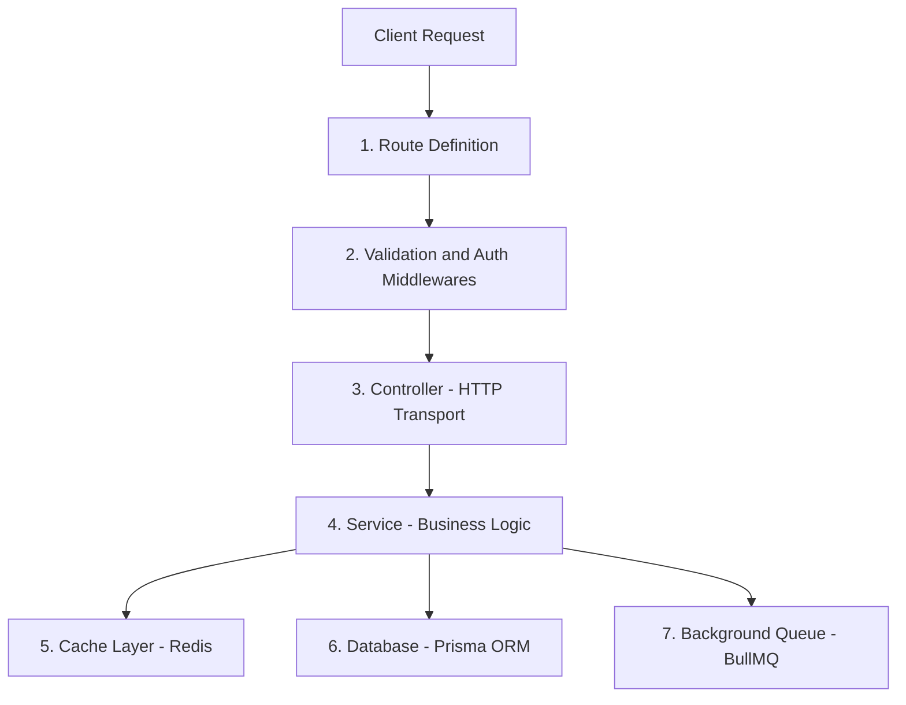
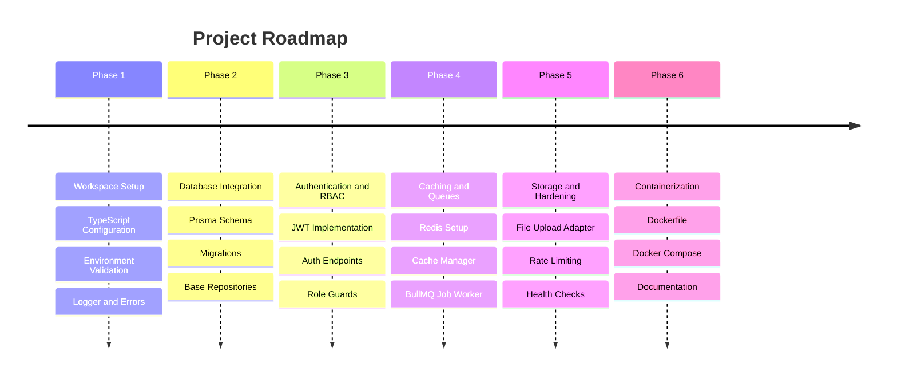

# Product Requirements Document (PRD)

## Project Name: Production-Grade Reusable Backend Boilerplate
**Version:** 1.0.0  
**Target Root Directory:** `/Users/manjeetyadav/Desktop/Backend`  
**Status:** Approved for Execution  

---

## 1. Project Overview and Objectives

### 1.1 Problem Statement
Writing backend infrastructure from scratch for every new project is inefficient, error-prone, and leads to inconsistent implementations of authentication, database access, validation, and error handling. This inconsistency slows down development velocity and complicates maintenance as applications scale.

### 1.2 Objective
Develop a production-grade, modular, scalable, and reusable backend boilerplate that:
- Covers the core 80% of functionality common to most modern web applications (e.g., SaaS, E-commerce, On-demand platforms).
- Adheres strictly to a layered architecture with separation of concerns.
- Runs natively on a local Node.js/TypeScript environment during development without requiring initial complex infrastructure.
- Integrates Docker and production containerization seamlessly at the final stage without modifying business logic.

---

## 2. Technology Stack

| Component | Choice | Justification |
| :--- | :--- | :--- |
| **Runtime** | Node.js (v20+ LTS) | Long-term support, stable performance, modern standard |
| **Language** | TypeScript (Strict Mode) | Static typing, early bug prevention, rich IDE support |
| **Framework** | Express.js (with TS) | Battle-tested, extensible, compatible with clean architecture |
| **Validation** | Zod | Runtime schema validation with compile-time type inference |
| **Database & ORM** | PostgreSQL + Prisma ORM | Relational consistency, type-safe queries, automated migrations |
| **Caching Layer** | Redis (ioredis) | High-speed in-memory store for session caching and rate limits |
| **Background Queue** | BullMQ (Redis-backed) | High-performance asynchronous job processing |
| **Authentication** | JWT (Access + Refresh) + Argon2/Bcrypt | Industry-standard token rotation and secure password hashing |
| **Logging** | Pino + Pino-Pretty | High-throughput structured JSON logging with low overhead |
| **Security** | Helmet, CORS, Express-Rate-Limit | Basic defense against common web vulnerabilities (XSS, DDoS, brute force) |
| **Containerization** | Docker & Docker Compose *(Final Phase)* | Standardized container builds and 1-click local service setups |

---

## 3. Architecture and Design Principles

### 3.1 Layered Architecture (Separation of Concerns)
Application execution follows a unidirectional 4-layer pattern:

1. **Route Layer:** Defines endpoints, HTTP methods, and routes traffic through middlewares.
2. **Middleware Layer:** Handles authentication, rate limiting, request tracing, and payload validation (Zod).
3. **Controller Layer:** Parses HTTP inputs, delegates to services, and returns standardized responses. Direct database operations are prohibited.
4. **Service Layer:** Encapsulates business logic, data mutations, and third-party integrations. Operates independently of Express `req` and `res` objects.
5. **Data Layer:** Handles schema definitions, queries, and transactions through Prisma ORM and Redis.

### 3.2 Core Architectural Invariants
- **Stateless Services:** No state or user session is retained in application memory.
- **Fail-Fast Configuration:** The application validates all required environment variables at boot time and terminates immediately if any are invalid.
- **Unified Response Schema:** Every API endpoint returns a predictable JSON structure for both success and error states.
- **Secrets Hygiene:** All credentials, database connection strings, and keys are injected strictly via environment variables.

---

## 4. Functional Modules

### Module 1: Core Infrastructure and Configuration
- TypeScript configuration (`tsconfig.json` with strict mode, `@/*` path mapping).
- Environment variable validation using Zod.
- Structured logger implementation (Pino) supporting `x-request-id` tracking.
- Standard response formatter (`ApiResponse.success`, `ApiResponse.error`).
- Centralized global error handling middleware with custom error classes (`BadRequestError`, `UnauthorizedError`, `ForbiddenError`, `NotFoundError`, `ConflictError`, `InternalServerError`).

### Module 2: Database and Migrations
- PostgreSQL connection initialization and lifecycle management via Prisma ORM.
- Connection health check probe.
- Database migration workflows (`npm run db:migrate`).
- Database seed pipeline for initialization and default role setup.

### Module 3: Authentication and Authorization
- User registration with password hashing (Argon2 / Bcrypt).
- Authentication via short-lived Access Tokens (15 min) and long-lived Refresh Tokens (7 days).
- Secure token storage using HttpOnly cookies.
- Refresh token rotation and session revocation flow.
- Role-Based Access Control (RBAC) middleware (`requireRole(['admin', 'user'])`).
- Rate limiting middleware on sensitive endpoints to protect against brute-force attacks.

### Module 4: Caching Layer (Redis)
- Redis connection wrapper with automatic reconnection and graceful failure handling.
- Generic cache utility:
  - `cache.get(key)`
  - `cache.set(key, value, ttlInSeconds)`
  - `cache.del(key)`
  - `cache.remember(key, ttlInSeconds, fetchCallback)` (Cache-Aside Pattern).

### Module 5: Asynchronous Background Job System (BullMQ)
- BullMQ worker and queue abstraction over Redis.
- Generic producer and consumer pipeline.
- Example notification worker (simulated email and OTP dispatch).
- Configurable retry strategies with exponential backoff.

### Module 6: Storage Abstraction
- File upload handling using Multer.
- Storage adapter interface:
  - `LocalStorageAdapter` for local development.
  - `S3StorageAdapter` / Cloud storage adapter, switchable via environment configuration.

### Module 7: Observability and Health Management
- Health check route (`/healthz`) reporting process status, database connectivity, and cache availability.
- Graceful shutdown handling for `SIGTERM` and `SIGINT` to drain active requests and disconnect pools safely.

### Module 8: Containerization (Final Step)
- Multi-stage production `Dockerfile` for lean deployment.
- `docker-compose.yml` for unified local execution (Application, PostgreSQL, Redis).
- Complete `.dockerignore` file.

---

## 5. Implementation Roadmap

### Phase 1: Foundation
- Initialize `package.json`, TypeScript, and core dependencies.
- Build folder structure (`src/config`, `src/common`, `src/modules`).
- Implement environment validation, logger, custom error classes, and server bootstrap.

### Phase 2: Database Integration
- Configure Prisma with PostgreSQL.
- Define initial User and Session schemas.
- Execute migrations and verify database connectivity.

### Phase 3: Authentication and Security
- Implement register, login, refresh, and logout endpoints.
- Add JWT verification middleware and role-based guards.
- Verify authentication lifecycle and token rotation.

### Phase 4: Redis and Asynchronous Queues
- Connect Redis client with connection pooling.
- Implement generic caching helper.
- Setup BullMQ worker and test background queue execution.

### Phase 5: Storage and Resilience
- Build pluggable file upload service (Local and Cloud adapters).
- Add security headers (Helmet), CORS, and rate limiters.
- Add health check probes and graceful shutdown hooks.

### Phase 6: Containerization and Documentation
- Create production Dockerfile and Docker Compose configurations.
- Validate local container execution.
- Create user guide and developer documentation for cloning and reusability.

---

## 6. Acceptance Criteria

The boilerplate is considered complete when:
1. The project builds with zero TypeScript errors under strict mode.
2. The application validates environment variables and aborts immediately on missing configuration.
3. Every endpoint returns predictable, structured response payloads.
4. Authentication supports secure token rotation with HttpOnly cookies.
5. Heavy tasks execute asynchronously via BullMQ without blocking the main event loop.
6. The entire stack can be launched via standard local commands and finalized with `docker compose up`.
