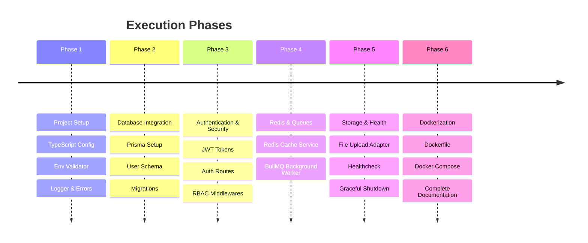

# 📋 Product Requirements Document (PRD)

## Project Name: Production-Grade Reusable Backend Boilerplate

**Version:** 1.0.0  
**Target Root Directory:** `/Users/manjeetyadav/Desktop/Backend`  
**Status:** Draft / Ready for Execution

---

## 1. 🎯 Project Overview & Objective

### 1.1 Problem Statement

Har naye project ya product ke liye backend scratch se likhna time-waste aur error-prone hota hai. Developers har baar wahi Authentication, Database setup, Error handling, Validation, aur Caching alag-alag tarike se implement karte hain, jisse code messy ho jata hai aur scale karte waqt dikkat aati hai.

### 1.2 Objective

Ek aisa **Production-Grade, Modular, Scalable aur Reusable Backend Boilerplate** tayyar karna jo:

- 80% kisi bhi product (E-commerce, SaaS, Social Media, Food Delivery) mein common ho.
- Clean **Layered Architecture** follow kare taaki koi bhi naya developer bina confusion ke code samajh sake.
- Shuruat mein bina kisi complex tool (bina Docker) ke aaram se local terminal par chale.
- End mein Docker aur Cloud-ready ho jaye bina kisi code change ke.

---

## 2. 🛠️ Tech Stack Selection

| Component            | Choice                                 | Reason                                                                      |
| :------------------- | :------------------------------------- | :-------------------------------------------------------------------------- |
| **Runtime**          | Node.js (v20+ LTS)                     | Stable, modern features support, industry standard                          |
| **Language**         | TypeScript (Strict Mode)               | Zero runtime typos, autocomplete, enterprise-level type safety              |
| **Framework**        | Express.js (with TS)                   | Sabse mature ecosystem, beginner-friendly aur clean architecture compatible |
| **Validation**       | Zod                                    | Runtime schema validation + compile-time type inference                     |
| **Database & ORM**   | PostgreSQL + Prisma ORM                | SQL reliability + type-safe queries + auto migrations                       |
| **Caching Layer**    | Redis (ioredis)                        | Fast in-memory key-value store for session and hot data                     |
| **Background Queue** | BullMQ (Redis-based)                   | High-performance background jobs (Emails, OTPs, heavy processing)           |
| **Authentication**   | JWT (Access + Refresh) + Argon2/Bcrypt | High security with HttpOnly cookies & token rotation                        |
| **Logging**          | Pino + Pino-Pretty                     | High performance structured JSON logging (10x faster than console.log)      |
| **Security**         | Helmet, CORS, Express-Rate-Limit       | Basic attack prevention (XSS, Clickjacking, Brute-force)                    |
| **Containerization** | Docker & Docker-Compose _(End Phase)_  | 1-click database & production deployment                                    |

---

## 3. 🏛️ Architecture & Design Principles

### 3.1 Layered Architecture (Separation of Concerns)

Har feature ka code 4 strict layers mein divide hoga:

```mermaid
graph TD
    Client[Client Request] --> Route[1. Route / URL]
    Route --> Middleware[2. Validation & Auth Middleware]
    Middleware --> Controller[3. Controller (HTTP Handler)]
    Controller --> Service[4. Service (Core Business Logic)]
    Service --> Cache[5. Redis Cache Check]
    Service --> Repo[6. Database / Prisma ORM]
    Service --> Queue[7. Background Worker]
```

1. **Route Layer:** URL aur HTTP method batata hai (`POST /api/v1/auth/register`).
2. **Middleware Layer:** Data validate karta hai (Zod) aur Auth check karta hai.
3. **Controller Layer:** Sirf HTTP request leta hai, status code return karta hai. _(No DB queries here!)_
4. **Service Layer:** Asli dimagh (Business Logic). Is layer ko HTTP ya Express ka pata bhi nahi hota, ye pure TypeScript function hoti hai.
5. **Data Layer:** Prisma models aur Redis cache operations.

### 3.2 Core Rules

- **Stateless API:** Server memory mein koi session ya user data save nahi hoga.
- **Fail-Fast Environment:** Agar `.env` mein koi zaroori variable miss hua toh server turant error dekar ruk jayega.
- **Consistent Responses:** Har API ka response structure exact same format mein hoga.
- **No Hardcoded Values:** Database URLs, secrets, ports sab environment variables se aayenge.

---

## 4. 📦 Detailed Functional Modules (Kya-Kya banega)

### Module 1: Core Foundation & Configuration

- [ ] TypeScript configuration (`tsconfig.json` with strict mode, path aliases `@/*`).
- [ ] Environment variable validation using `Zod` (Fail-Fast schema).
- [ ] Structured Logger setup using `Pino` (with `x-request-id` request tracking).
- [ ] Centralized Standard Response Formatter (`ApiResponse.success`, `ApiResponse.error`).
- [ ] Global Error Handler Middleware with custom Error classes (`BadRequestError`, `UnauthorizedError`, `NotFoundError`, `InternalServerError`).

### Module 2: Database & Migrations

- [ ] PostgreSQL setup with Prisma ORM.
- [ ] Database connection pooling & health check probe.
- [ ] Migration scripts (`npm run db:migrate`, `npm run db:studio`).
- [ ] Seed script for dummy data / initial admin user.

### Module 3: Authentication & Security (Enterprise Grade)

- [ ] User Registration & Password Hashing (Argon2 / Bcrypt).
- [ ] Login with JWT (Short-lived Access Token: 15m) + (Long-lived Refresh Token: 7d).
- [ ] Refresh Token Rotation flow (Automatic new access token generation).
- [ ] Logout flow (Revoke token / Clear HttpOnly cookie).
- [ ] Role-Based Access Control (RBAC) Middleware (`requireRole(['admin', 'vendor'])`).
- [ ] Security middlewares: `helmet`, `cors`, `rate-limiter` (Brute-force protection).

### Module 4: Pluggable Caching Engine (Redis)

- [ ] Redis connection manager (auto-reconnect, fail-safe).
- [ ] Generic Cache Service wrapper:
  - `cache.get(key)`
  - `cache.set(key, value, ttl)`
  - `cache.del(key)`
  - `cache.remember(key, ttl, fetchFunction)` _(Cache-Aside Pattern)_.

### Module 5: Asynchronous Background Job System (BullMQ)

- [ ] BullMQ queue manager setup using Redis.
- [ ] Generic Job Producer & Consumer pattern.
- [ ] Example Worker: Email / Notification Dispatcher (Welcome Email, OTP).
- [ ] Automatic retry logic on failure (Exponential backoff).

### Module 6: File Storage Abstraction

- [ ] File upload middleware (Multer for multipart data).
- [ ] Pluggable Storage Adapter interface:
  - `LocalStorageAdapter` (saves to `./uploads` for local dev).
  - `S3StorageAdapter` / `CloudinaryAdapter` (easily switchable via `.env`).

### Module 7: Health Checks & Graceful Shutdown

- [ ] `/healthz` endpoint (checks API status, DB connection, Redis connection).
- [ ] Graceful Shutdown handlers for `SIGTERM` and `SIGINT` (safe connection closing without dropping requests).

### Module 8: Docker & Production Readiness _(Final Step)_

- [ ] Multi-stage production `Dockerfile` (optimized for lightweight image).
- [ ] `docker-compose.yml` for local 1-click setup (App + PostgreSQL + Redis).
- [ ] `.dockerignore` file.

---

## 5. 🗺️ Step-by-Step Implementation Roadmap



### Phase 1: Foundation (Zero External Dependencies)

- Initialize `package.json`, install TypeScript, ESLint, Prettier.
- Setup folder structure (`src/config`, `src/common`, `src/modules`).
- Implement Zod-based `.env` validator and custom error classes.
- Test server run on `http://localhost:5000`.

### Phase 2: Database & Models

- Setup Prisma and connect to PostgreSQL.
- Create User and Session models.
- Run initial migration and verify connection.

### Phase 3: Auth & Business Logic

- Implement Register, Login, Refresh, and Logout endpoints.
- Implement Auth Middleware (`protect` & `restrictTo`).
- Test complete auth flow via Postman / REST Client.

### Phase 4: Redis & Queues

- Add Redis client wrapper.
- Implement Caching for User Profile endpoint.
- Setup BullMQ and test sending background simulation job.

### Phase 5: Storage & Resilience

- File upload service (Local vs S3 adapter).
- Rate limiting & Security headers.
- Graceful shutdown hooks.

### Phase 6: Docker (The Final Touch)

- Write `Dockerfile` and `docker-compose.yml`.
- Run whole stack via `docker compose up`.
- Create a simple `README.md` on how to clone and reuse this backend for any future product.

---

## 6. ✅ Acceptance Criteria (Definition of Done)

Is project ko tab complete mana jayega jab:

1. Koi bhi naya developer repository clone kare aur `.env` copy karke `npm run dev` chalaye toh bina kisi issue ke server start ho jaye.
2. Har response standard JSON format mein ho aur errors neatly formatted hon (koi unhandled crash na ho).
3. Auth system fully functional ho with Access + Refresh tokens.
4. Heavy tasks (like email simulation) background queue mein execute ho bina main API ko block kiye.
5. End mein `docker compose up` command se pura backend + database + cache chal jaye.
